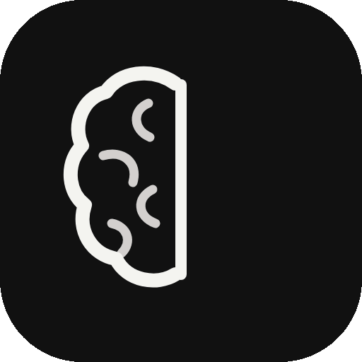

<div align="center">

# 🧠 ReCall

**A Windows app for studying smarter with spaced repetition and the forgetting curve.**
<br>
مراجعات ذكية بالتباعد الزمني


[](LICENSE)

<br>

<picture>
  <source media="(prefers-color-scheme: dark)" srcset="recall-logo-animated.gif">
  
</picture>

</div>

---

## ✨ Features

- **Forgetting curve:** see how much you still remember of each subject, and which one to review first.
- **AI-made quizzes:** copy a ready prompt, send it with your lecture to any AI, then drag the JSON file it gives you into a subject.
- **Flashcards and multiple choice:** two quiz modes, plus a "review my mistakes" round.
- **Neural map of subjects:** unlimited nested sub-topics, connected with animated memory threads.
- **Your layout:** long-press to move subjects anywhere, and pick a background (code, aurora, dots, grid, or your own image).
- **Dark and light themes** with a full Arabic (RTL) interface.
- **Private by default:** everything stays on your device, with no account and no server.

## 📥 Download

Get the latest installer from the [**Releases**](../../releases/latest) page and run `ReCall-Setup-1.0.0.exe`.

> [!NOTE]
> The installer isn't code-signed yet. If Windows shows *"Windows protected your PC"*, click **More info → Run anyway**.

## 💾 Where is my data?

Everything is saved in a local SQLite database on your PC:

```
%APPDATA%\ReCall\recall.db
```

Use the **File** menu to back it up or restore it. Uninstalling ReCall keeps your data.

## 📄 License

Released under the [MIT License](LICENSE).

<div align="center">
<br>

Made with ❤️ for anyone who'd rather remember than re-read.

</div>
